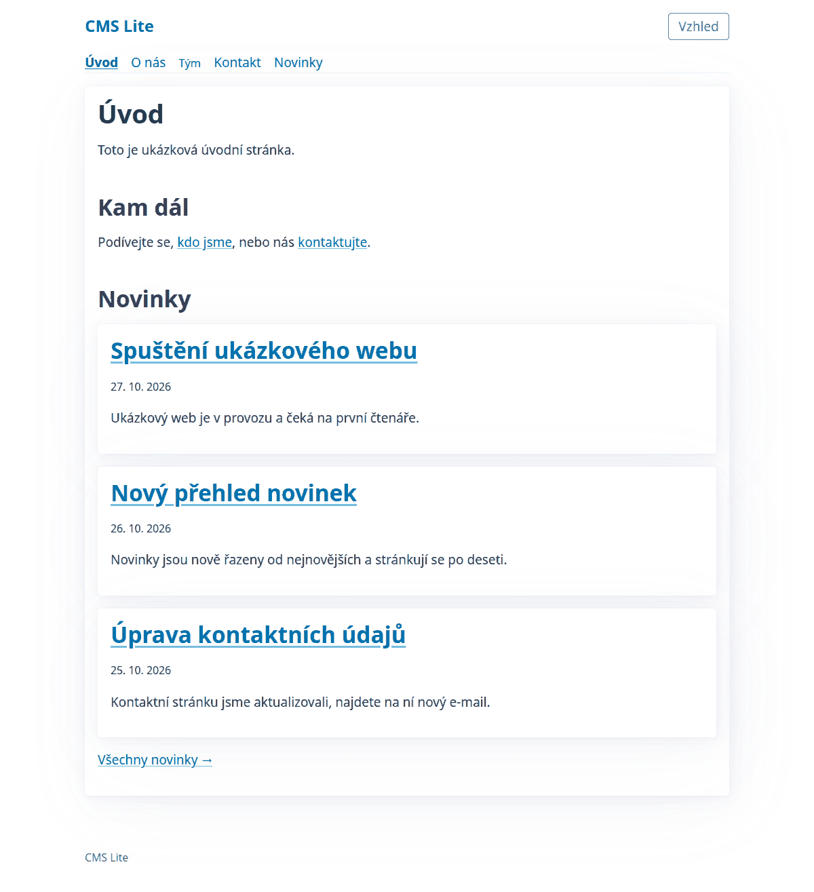
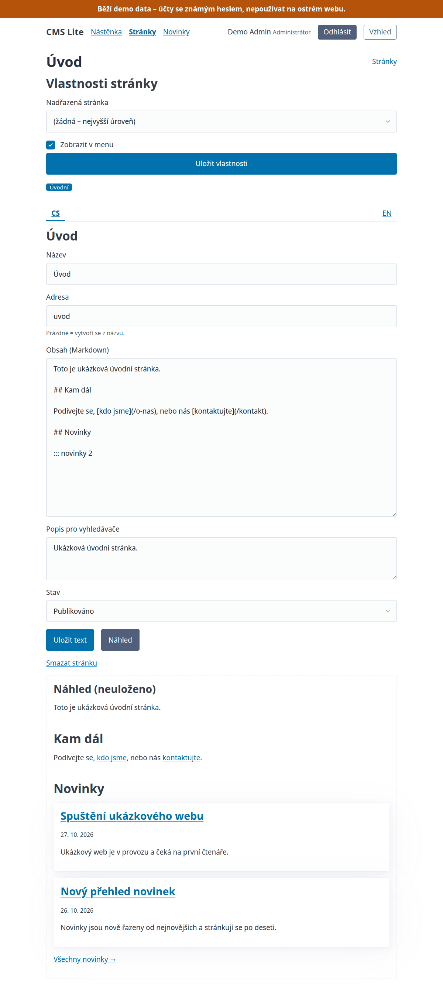
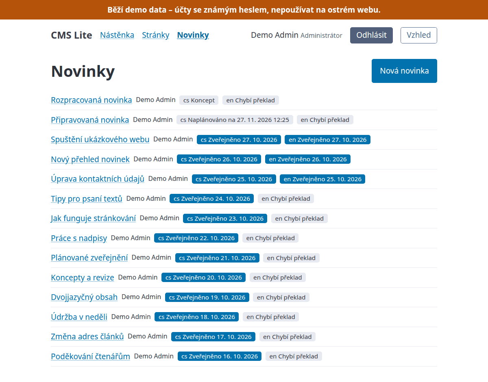

# cms-lite-nette

[](https://github.com/jantydlacka/cms-lite-nette/actions/workflows/ci.yml)
[](https://github.com/jantydlacka/cms-lite-nette/actions/workflows/ci.yml)

A small, well-structured CMS built on [Nette](https://nette.org) 3.3 and PHP 8.3+: pages, news and components in Markdown content, with an administration for editors. It is the first of a planned family, `cms-lite-<framework>`: every implementation follows the same specification in [`spec/`](spec/) and is checked by the same browser-level end-to-end suite in [`e2e/`](e2e/).

The project is meant to be read as much as used. Worth a look:

- **Architecture with ports and adapters.** The domain (`app/Model/`) talks to the database only through interfaces such as `PageRepository` and `NewsRepository`; the Nette Database implementations live in a `Database/` sub-namespace of each domain (`app/Model/Page/Database/`). The dependency direction is enforced by [phpat](https://github.com/carlosas/phpat) rules in PHPStan: the domain may use only `Nette\Utils`, `Nette\Schema` and `Psr\Clock` from vendors, never the presentation layer or `App\Core`, and nothing above the domain may reach an adapter directly. The reasons are in [`docs/adr/`](docs/adr/).
- **Tests on every level.** Nette Tester unit and integration tests against MySQL (each parallel test thread gets its own database), architecture rules, and Playwright end-to-end tests that check production behaviour in a real browser. PHPStan at level max without a baseline and Psalm taint analysis run in the same gate.
- **Multilingual-ready.** Pages and news are stored as one item with a translation per language; the default language has no URL prefix (`/o-nas`), other languages have one (`/en/about-us`). The demo data enables English next to Czech. All UI texts go through a translator.
- **Safe Markdown with components.** Raw HTML in content is escaped and unsafe links are dropped. A line such as `::: novinky 3` places a component (the latest news); unknown or malformed markers are refused on save with the line number.



## Features

- Public pages from the database: flat URLs, menu, breadcrumbs, 301 redirects from old addresses, light/dark theme.
- News: a paginated public list and detail pages, scheduled publication.
- Sign-in with two roles (editor, administrator), rate-limited failed attempts, users created from the command line.
- Page administration: the page tree, one screen per page with a tab per language, preview, optimistic locking against concurrent edits, homepage selection.
- News administration with publication dates and drafts.
- Components in content, with a preview in the administration.
- Demo data with public demo accounts, for trying it out.

| Page detail with the preview of `::: novinky 2` | News in the administration |
| --- | --- |
|  |  |

Status: MVP – pages, sign-in, page and news administration, components. Images and a contact form are planned next. The CI workflow is configured but has not run yet, so there are no published runs, and the coverage badge shows as broken until the first CI run on `main` publishes it.

## Quick start

Requires only Docker (with Compose).

```bash
git clone https://github.com/jantydlacka/cms-lite-nette.git
cd cms-lite-nette
# Linux only (GNU sed; macOS/Windows: skip the next line): run the app container as your user, so vendor/, temp/ and log/ stay yours
touch .env && sed -i '/^CMS_[UG]ID=/d' .env && printf 'CMS_UID=%s\nCMS_GID=%s\n' "$(id -u)" "$(id -g)" >> .env
docker compose up -d --build
docker compose exec app composer install
docker compose up -d --wait
docker compose exec app bin/console migrations:continue
```

Then open <http://localhost:8080> and sign in at <http://localhost:8080/admin> with a [demo account](#demo-accounts).

From a fresh clone to a signed-in demo administrator took about 2.5 minutes (141 seconds of command time) in a measured run on Linux, with the `mysql:8.4` and `composer:2` images already present; the PHP base image and the Composer packages were downloaded during the run. Most of it, about 100 seconds, was building the PHP image, which later starts reuse.

On Linux the `.env` line matters: the container runs as `CMS_UID:CMS_GID` (default `1000:1000`), and files it creates in the bind-mounted project belong to that user. `.env` must contain the actual numbers (Compose does not evaluate `$(id -u)` inside `.env`); the command above writes them (it replaces any earlier `CMS_UID`/`CMS_GID` lines, so running it twice adds no duplicates).

The order matters: the container health check requests `/_health`, which needs `vendor/`, so the first `up` cannot become healthy until `composer install` has run; the second `up -d --wait` waits for that. `/_health` does not use the database, so it turns healthy before the migrations run; it answers `503` while an asset the layout needs is missing.

## Demo accounts

When demo data is enabled (`CMS_DEMO_DATA=1`, or unset in debug mode), two accounts exist. Their passwords are public:

| E-mail | Password | Role |
| --- | --- | --- |
| `admin@example.com` | `demo-admin-password` | admin |
| `editor@example.com` | `demo-editor-password` | editor |

**Demo data must never run on a live site.** While it is enabled, the administration shows a warning banner. Sign in at <http://localhost:8080/admin>.

## Configuration

Database settings come from the `CMS_DB_*` environment variables. In production all of them must be set and non-empty, otherwise boot fails; the development defaults apply only in debug mode. `config/local.neon` (gitignored), if present, is loaded in every mode and may override any setting, including `database:`, on top of those values.

Both ports are published on `127.0.0.1` only. They can be changed in `.env`:

```
CMS_HTTP_PORT=8081
CMS_DB_HOST_PORT=3308
```

### Environment variables

| Variable | Used by | Meaning |
| --- | --- | --- |
| `CMS_UID`, `CMS_GID` | Compose | User and group the app container runs as; default `1000`. |
| `CMS_HTTP_PORT` | Compose | Host port of the web server; default `8080`. |
| `CMS_DB_HOST_PORT` | Compose | Host port of the bundled MySQL; default `3307`. |
| `MYSQL_ROOT_PASSWORD` | Compose | Root password of the bundled MySQL, also passed to the app as `CMS_DB_PASSWORD`; default `root`. |
| `NETTE_DEBUG` | App | `1` = debug mode (Tracy, translator in strict mode); any other value or unset = production. Compose sets `1` unless overridden. |
| `CMS_DEMO_DATA` | App | `1` = migrations include demo data, any other value = no demo data; unset follows debug mode. |
| `CMS_DB_HOST`, `CMS_DB_PORT`, `CMS_DB_NAME`, `CMS_DB_USER`, `CMS_DB_PASSWORD` | App | Database connection. Compose sets them for the bundled MySQL (`CMS_DB_PORT` is the port inside the Docker network, `3306`, not the host port). In debug mode unset or empty values fall back to `127.0.0.1`, `3306`, `cms`, `root`, `root`; in production every one must be set and non-empty, otherwise the application refuses to boot. |

### Development mode

`NETTE_DEBUG=1` is the default in the compose setup. In this mode an unknown URL shows the Tracy error screen, not the 404 page. Set `NETTE_DEBUG=0` (in `.env` or the shell, then `docker compose up -d`) to see production behaviour. `CMS_DEMO_DATA=1` or `0` forces demo data on or off; when unset it follows debug mode. Demo data also enables the `en` language; to enable a second language without it, add `cms: locales: [cs, en]` to `config/local.neon`.

### Application settings

The `cms:` section of `config/common.neon` (override it in `config/local.neon`; when demo data is enabled, `config/demo.neon` is loaded as well and only sets `locales: [cs, en]`). Keys not set there use the defaults below:

| Key | Default | Meaning |
|-----|---------|---------|
| `timezone` | `Europe/Prague` | Time zone for showing and entering dates (news publication). Must be a valid identifier; times are stored in UTC. |
| `newsInMenu` | `true` | Shows the news link at the end of the top menu. |
| `newsPerPage` | `10` | News items per page of the public list. |
| `components` | `novinky: App\Model\News\NewsListComponent` | Map of component name to a class implementing `App\Model\Content\ContentComponent`; see [Components](#components). |

## Development

### Migrations

Migration files are ordered by file name across all groups (`structures`, `basic-data`, `dummy-data`), not per group: `migrations:continue` refuses the whole run when a pending file sorts before the latest executed one in any group. Hence the rule for development: every new migration file, in any group, gets a name that sorts strictly after every migration name in the base branch, across all groups. All groups share one sequence, `YYYY-MM-DD-NNNN-name.sql`; never backdate a file or reuse a number. When two branches add migrations, whoever merges second renames their files to follow the other branch's. `bin/check-migrations-immutable` enforces this (see [Quality](#quality)).

Released migrations are never edited; a fix is always a new migration.

After pulling a new version, run `docker compose exec app bin/console migrations:continue` to apply new migrations.

After upgrading from a build in which a released migration was edited locally, run `migrations:reset` on the development database (it drops all data); `migrations:continue` refuses a changed migration. Enabling the demo data on a database migrated without it also needs `migrations:reset`: migrations are ordered globally by file name, so demo files that sort before already executed ones are refused.

## Quality

Everything runs inside the container:

```bash
docker compose exec app composer qa
```

`composer qa` runs lint (PHP, NEON, Latte), coding standard, PHPStan at level max without a baseline, Psalm taint analysis, the forbidden-words check and the Nette Tester suite (which includes the architecture rules); `composer qa:checks` runs everything except the test suite. Psalm taint analysis covers SQL, file paths and shell commands; it does not cover XSS, which Latte's autoescaping handles.

Install the git hooks (pre-commit and pre-push run parts of the gate):

```bash
docker compose exec app composer hooks:install
```

End-to-end tests run from the host against a running stack and need Node.js 20 or newer on the host (only for these tests). The contract is production behaviour, so run the stack with `NETTE_DEBUG=0` and the demo data loaded (`CMS_DEMO_DATA=1` for the web container as well, since the demo data enables the `en` language); clear the container cache first, because production mode does not refresh it:

```bash
rm -rf temp/cache
export NETTE_DEBUG=0 CMS_DEMO_DATA=1
docker compose up -d --wait
docker compose exec -T app bin/console migrations:reset
cd e2e && npm ci && npx playwright install chromium
E2E_BASE_URL=http://localhost:8080 npx playwright test
```

Set `E2E_BASE_URL` to your `CMS_HTTP_PORT`. Against a debug-mode stack (`NETTE_DEBUG=1`) the 404 checks fail and the Tracy bar logs console errors; add `E2E_IGNORE_CONSOLE_PATTERN=_tracy_bar` to skip those, see [`spec/README.md`](spec/README.md). Return to development mode with `unset NETTE_DEBUG CMS_DEMO_DATA; rm -rf temp/cache; docker compose up -d --wait`.

The pre-push hook and CI also run `bin/check-migrations-immutable [--order-base <ref>] [base]`. It makes two checks:

- **Immutability:** fails when a migration that exists in `base` was modified, deleted or renamed (compared from the merge base of `base` and `HEAD`).
- **Order:** fails when a migration added since the order base does not sort after every migration at the tip of the order base. The order base is `--order-base` when given, otherwise `base`; only `*.sql` and `*.php` files count (the files the migration runner executes), so `.gitkeep` or a `README.md` are ignored. A missing `--order-base` value, an unknown option or a second base exits with 2.

Which base each check uses:

| Where | Immutability | Order |
| --- | --- | --- |
| pre-push hook | `origin/main`; without it, the merge base with the local `main` | the same |
| CI, pull request | `origin/<target branch>` | the same |
| CI, push to a branch other than `main` | the previous push (a new branch: the merge base with `origin/main`) | `origin/main` |
| CI, push to `main` | the previous push | the same |

On a branch push the order is judged against `origin/main`, because files merged in from `main` count as added against the previous push. The hook prints a warning and skips both checks when neither `origin/main` nor `main` exists, or when `main` itself is checked out.

## First administrator

Users are created from the command line (there is no administration UI for it yet). Interactively, the password is asked twice and not echoed:

```bash
docker compose exec app bin/console user:create admin@example.com "Jane Admin"
```

For scripts, pass the password on standard input (first line; only the line ending is stripped) so it does not appear in the process list:

```bash
printf '%s\n' "$PASSWORD" | docker compose exec -T app bin/console user:create admin@example.com "Jane Admin" --password-stdin
```

`--role=editor` creates an editor; the default is `admin`. Passwords have at least 12 characters and at most 72 bytes, no leading or trailing whitespace and no control characters (a tab is allowed). The e-mail is trimmed and lower-cased, and a non-ASCII domain is stored as punycode (`jan@žluť.cz` → `jan@xn--lu-yta1h.cz`), the form the browser sends; a non-ASCII local part is refused.

Failed sign-ins are rate limited per e-mail and IP address and per IP address alone (limits in `cms: login:`); a blocked client cannot sign in even with the right password. Sessions end when the browser closes or after 3 hours of inactivity.

### Cookies

The public site starts no session. The only technical cookie it may set is `_nss`, Nette's CSRF fallback for browsers that do not send `Sec-Fetch-Site`. A session cookie exists only in the administration.

## Administration

Sign in at `/admin`. Editors and administrators manage pages under `/admin/pages`; the full list of addresses and responses is in [`spec/urls.md`](spec/urls.md#pages).

- **Addresses:** `/admin/pages` (the tree), `/admin/pages/new`, `/admin/pages/<id>` (the default language), `/admin/pages/<id>/<locale>` (another enabled language; any other is 404) and `/admin/pages/<id>/delete` (the confirmation). Every change is a POST form from the same origin; a GET never changes anything.
- **One screen per page:** the page properties (parent, menu flag) on top, below them one tab per enabled language with its own form; a save stores one language. Tabs appear only with more than one language; a missing translation is added from its tab. The parent dropdown offers neither the page itself nor its descendants. ↑/↓ in the tree swap a page with its sibling.
- **Address (slug):** left empty, it is derived from the title (at most 100 characters). It then stays when the title changes; a manual change makes the old address redirect (301) to the new one.
- **Preview:** **Náhled** renders the content below the form through the same Markdown renderer as the public site and saves nothing.
- **Versions and concurrent edits:** the properties and every translation carry a version number that each save raises by one. A save based on an older version stores nothing and shows `admin.pages.stale`; the sent text stays in the form, to be copied over the current version. A save whose sign-in expired comes back after sign-in as the filled form, unsaved.
- **Homepage:** **Nastavit jako úvodní** works only for a page with a published translation in the default language. The homepage cannot be deleted and its default-language translation cannot become a draft until another page is chosen. Its detail lists the enabled languages without a published translation, whose root (`/en/` …) is 404.
- **Deleting:** only a whole page, with all its languages, after a confirmation screen. A page with subpages or the homepage cannot be deleted. Redirects to a deleted page are removed too, so its old addresses become 404. A single translation is hidden by switching it to a draft.

### News

Editors and administrators manage news under `/admin/news` (addresses and responses in [`spec/urls.md`](spec/urls.md#admin-news)). A news item has a publication date shared by its languages and one translation per language (title, address, perex, Markdown content, search description, draft/published status). It is visible on the website when its translation is published and the date has passed, so a future date schedules it. The date is entered in the `timezone` of the configuration; empty means "now" at the moment of publishing. A changed address redirects the old one (301), and deleting the item removes the redirects.

### Components

The content of a page or a news item can place a component on a line of its own. The built-in one lists the latest news:

```
## News

::: novinky 3
```

`::: novinky N` shows the N newest visible news items of the content's language (N is a whole number from 1 to 20; `::: novinky` means 3), each with title, date and perex, followed by a link to the full list. Without visible news the website shows nothing and the preview says so. The component cannot be placed in a news item. The demo homepage uses it.

Saving content with an unknown, malformed or misplaced marker is refused with the line number, and the text stays in the form. The preview shows the problem in place of the marker. To write a line that starts with `:::` as plain text, write `\:::`; in a fenced or inline code span nothing is processed. The full grammar and examples are in [`spec/components.md`](spec/components.md).

To add a component, implement `ContentComponent` and register it under a name in `cms: components:`. The components listed there are added to the built-in `novinky`, which cannot be removed.

## Deployment note

Behind a reverse proxy, set Nette's trusted proxies. Without them the rate limit sees the proxy's address instead of the client's, so one client can block everyone, and behind a TLS-terminating proxy the application does not detect HTTPS (from `X-Forwarded-Proto`/`Forwarded`), so the browser receives `http://` asset URLs on an HTTPS page (mixed content). Asset URLs and redirect `Location` headers are absolute URLs built from the request `Host`, so also set `ServerName` at deployment.

```neon
http:
	proxy: [192.0.2.10]  # address or CIDR range of your proxy
```

Run `bin/console migrations:continue` on every deploy. It stops before applying anything when a pending migration sorts before an already executed one (see the naming rule under [Migrations](#migrations)); a release must never ship such a file.

Clear `temp/cache` on every deploy: in production mode the container and template caches are not rebuilt when the code changes.

Deploy `www/assets/` together with the templates: when an asset file referenced by a template is missing, the page breaks in production mode – the response still has status 200, but the HTML stops inside `<head>` and the generic server error screen follows (the error is logged).

## Documentation

- [`docs/adr/`](docs/adr/) - architecture decision records for the interfaces
- [`spec/`](spec/) - the specification shared by all `cms-lite-<framework>` implementations (URLs, messages, components, test ids)

## License

MIT, see [`LICENSE`](LICENSE).
